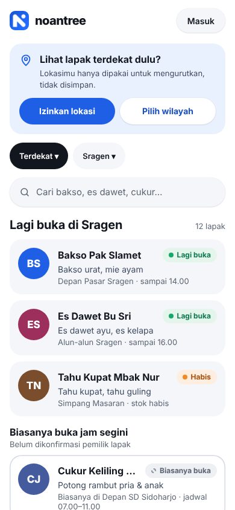
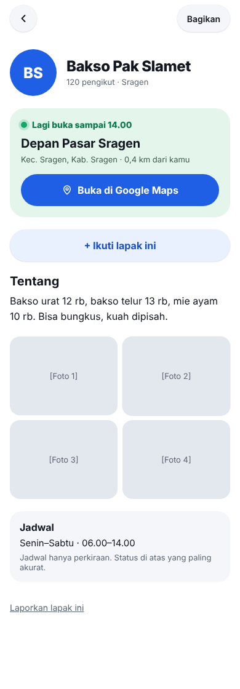
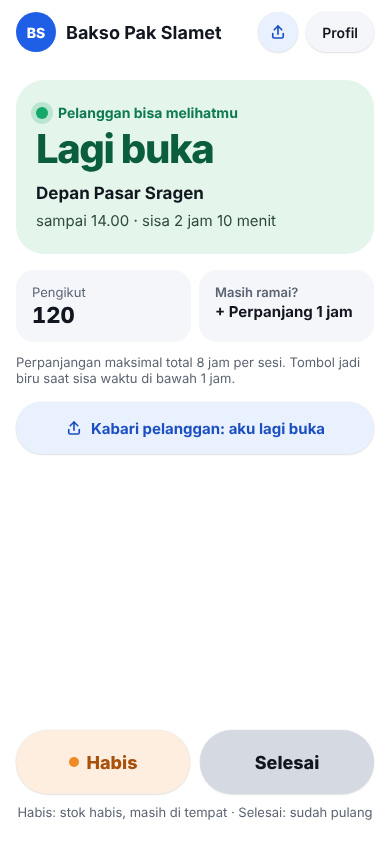
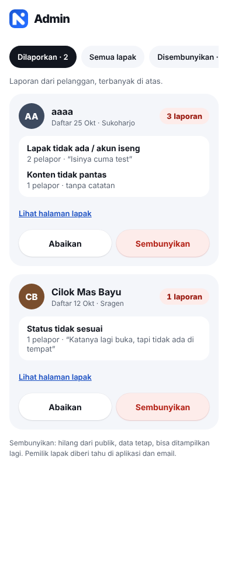

# noantree

**Status buka-tutup pedagang keliling, tanpa instal aplikasi.**
Pelanggan melihat lapak mana yang sedang buka, di mana, dan sampai jam berapa. Pemilik lapak cukup menekan satu tombol.

Situs: [noantree.id](https://noantree.id) · PWA (React + Supabase + Cloudflare Workers)

> **Repo ini adalah versi portofolio** dari proyek noantree: kode aplikasi, skema database, PRD, dan desain layar. ID proyek, email, dan konfigurasi lingkungan sudah diganti placeholder. Riwayat commit sengaja dimulai dari awal. Aplikasi yang berjalan di produksi memakai repo privat terpisah.

| | |
| --- | --- |
| Pembuat | Aji (Faisal Kusuma Aji), product + desain + build |
| Dimulai | Oktober 2026 (PRD pertama 25 Okt 2026) |
| Status | MVP masih dibangun dan terus berlanjut. **Belum ada pengguna nyata**; pilot 5–10 lapak di Sragen sedang disiapkan |
| Peran | Riset awal, PRD, desain 54 layar, pembangunan lewat alur kerja dengan asisten AI (Claude Code), pengujian, dan operasional |

## Masalah

Pedagang keliling dan lapak kecil tidak punya tempat atau jam tetap. Pelanggan sering datang sia-sia, dan pedagang kehilangan pembeli yang sebenarnya mencari mereka.

Dari wawancara awal dengan 5 pedagang (2 penjual nasi goreng, 1 penjual jenang OTR, 2 tukang cukur langganan), polanya berulang:

- Pedagang yang harus pindah lokasi (sewa lapak habis atau naik) kehilangan hampir semua pelanggan lamanya.
- Pelanggan sering kecele karena lapak tidak jualan atau dagangan sudah habis.
- Beberapa pedagang kasihan melihat pelanggan antre lama, atau pelanggannya datang bersamaan (sangat ramai atau sangat sepi).

Sampel kecil dan belum divalidasi lebih luas. Indikator antre sengaja **tidak** masuk MVP karena konsep dasarnya belum terbukti.

## Solusi (lingkup MVP)

- **Pelanggan** melihat, memfilter (wilayah), dan mencari lapak tanpa login. Login hanya untuk mengikuti dan melaporkan lapak.
- **Pemilik lapak** mendaftar (3 langkah: profil, tempat, jadwal), lalu menandai status dengan satu tombol: *Lagi buka*, *Habis*, *Tutup*, atau *Biasanya buka*.
- **Admin** meninjau laporan dan menyembunyikan lapak bermasalah (moderasi reaktif, tanpa persetujuan di muka).
- Bagikan lapak lewat link dan QR untuk gerobak; pasang ke layar utama sebagai PWA.

Pilihan produk yang disengaja: tumbuh dulu (tanpa approval admin, validasi dasar otomatis), jam operasional opsional, lokasi lapak diisi dari tautan Google Maps ditambah dropdown wilayah, dan lokasi pelanggan tidak pernah dikirim ke server.

## Tampilan (desain)

Gambar di bawah adalah **desain layar**, bukan tangkapan layar produksi. Seluruh 54 layar ada di [`docs/desain/png`](docs/desain/png).

| Beranda pelanggan | Detail lapak | Pemilik: lagi buka | Admin: dilaporkan |
| --- | --- | --- | --- |
|  |  |  |  |

## Cara kerja produk

Dokumen yang dihasilkan selama proyek, semuanya ada di repo:

| Dokumen | Isi |
| --- | --- |
| [`docs/PRD.md`](docs/PRD.md) | Ringkasan, pengguna dan istilah, model data, **52 aturan bisnis (A1–A52)**, spesifikasi per layar, keamanan dan privasi, rencana 7 sprint, definisi selesai |
| [`docs/desain/`](docs/desain) | 54 layar (PNG + sumber HTML) yang dirujuk PRD dengan kode V0–V55 |
| [`docs/PROSES.md`](docs/PROSES.md) | Tiga lingkungan (laptop, staging, produksi), alur fitur → staging → main, aturan migrasi |
| [`docs/draf-kebijakan-sk.md`](docs/draf-kebijakan-sk.md) | Draf Kebijakan Privasi dan Syarat & Ketentuan (belum final) |
| [`CLAUDE.md`](CLAUDE.md) | Aturan kerja untuk asisten AI: sumber kebenaran, aturan wajib, cara bekerja |

Setiap tugas coding merujuk sprint, kode layar (V#), dan nomor aturan (A#), sehingga hasil AI bisa diperiksa terhadap dokumen, bukan ditebak.

## Teknologi dan arsitektur

- **Frontend:** React 19, Vite, TypeScript, Tailwind CSS 4, PWA (`vite-plugin-pwa`), Leaflet untuk peta
- **Backend:** Supabase: Postgres, Auth (Google + magic link), Row Level Security, Storage, Edge Function (`cek-link-maps`)
- **Hosting:** Cloudflare Workers dengan static assets; Worker kecil untuk pratinjau link per lapak (judul/OG tag untuk WhatsApp)
- **Lingkungan:** laptop → staging (database terpisah) → produksi

Keputusan teknis yang layak dilihat:

- **Semua perubahan database lewat migrasi bernomor** ([`supabase/migrations`](supabase/migrations), 003–030) dan tiap tabel memakai RLS.
- **Status publik hanya lewat view `lapak_publik`**; tabel sesi buka hanya ditulis lewat fungsi (`mulai_buka`, `ubah_status`, `perpanjang`, `selesai`, `batalkan_selesai`).
- **Uji SQL** untuk aturan dan hak akses di [`supabase/tests`](supabase/tests).
- **Semua logika jam memakai WIB**, bukan waktu server.
- **Kunci rahasia tidak ada di kode**; aplikasi hanya memakai kunci anon publik.
- Batas penyalahgunaan: maks. 10 cek link Maps per pemilik per hari, 1 laporan per pelanggan per lapak per periode, deskripsi lapak tanpa tautan.
- Skrip uji logika di [`scripts`](scripts) (validasi origin CORS, pratinjau Worker, parser link Maps, kebijakan).

## Menjalankan secara lokal

Butuh Node 22+ dan proyek Supabase milikmu sendiri (repo ini tidak menyertakan akses ke data atau proyek asli).

```bash
npm ci
cp .env.example .env.local   # isi URL dan kunci anon proyek Supabase-mu
npm run dev                  # http://localhost:5173
```

Database dibuat dengan menjalankan migrasi di `supabase/migrations` berurutan (lihat [`docs/PROSES.md`](docs/PROSES.md)). Pengecekan umum: `npm run build`, `npm run lint`, `npm run uji:origin`.

## Yang belum ada (jujur)

- Belum ada pengguna nyata dan belum ada metrik; ukuran keberhasilan (lapak aktif mingguan, retensi pemilik, akun yang mengikuti) sudah didefinisikan di PRD tetapi target angkanya belum diisi.
- Kebijakan Privasi dan S&K masih draf.
- Ide lanjutan (rating, halaman link lapak, add-on per kategori, langganan, affiliate) masih tahap validasi, belum dibangun.

## Lisensi

Hak cipta © 2026 Aji. **Seluruh hak dilindungi.** Kode dan dokumen dibuka untuk dibaca dan dinilai sebagai portofolio; tidak diberi lisensi untuk dipakai ulang, disalin, atau dijalankan sebagai layanan tanpa izin tertulis.

## Catatan tentang alamat email di repo ini

Semua alamat email yang muncul di repo ini adalah **data contoh (dummy)** dan **tidak aktif**. Ini berlaku untuk alamat berakhiran `@contoh.invalid` di kode, uji SQL, draf kebijakan, dan mockup desain, juga untuk email pada gambar di `docs/desain/png` (misalnya `aji@gmail.com` atau `slamet.bakso@gmail.com`). Domain `.invalid` memang tidak bisa dikirimi email, dan alamat pada gambar hanyalah contoh tampilan. Jangan kirim pesan ke alamat-alamat itu.

**Satu-satunya email aktif untuk menghubungi pembuat adalah `faisalkaji01@gmail.com`.**

## Kontak

Email: faisalkaji01@gmail.com. Atau buka *issue* di repo ini, atau lewat profil GitHub [@Noantree](https://github.com/Noantree).
